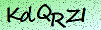

# MKU CAPTCHA OCR

Python CLI lấy CAPTCHA từ cổng MKU hoặc đọc ảnh có sẵn, sau đó nhận dạng chuỗi gồm đúng 6 ký tự ASCII chữ hoa, chữ thường và chữ số. Kết quả giữ nguyên hoa/thường. OCR có thể sai; trường `status` chỉ cho biết độ dài kết quả hợp lệ, không xác nhận chuỗi khớp với máy chủ.

<p align="center">
  
</p>

Phát triển: Thái Nguyên — Telegram: [@tn2k6](https://t.me/tn2k6)

## Cài đặt

Yêu cầu Python 3.10 trở lên.

```bash
python -m venv .venv
source .venv/bin/activate
python -m pip install -r requirements.txt
```

## Kiến trúc dự án (AI Microservice & API Product)

```text
captcha-mku/
├── app/                         # 🚀 FASTAPI MICROSERVICE & REST API
│   ├── main.py                  # FastAPI router (/health, /api/v1/solve/*)
│   ├── service.py               # Singleton ONNX OCR Service & warmup
│   └── schemas.py               # Pydantic request/response schemas
├── training/                    # 🧠 ML TRAINING & BENCHMARK PIPELINE
│   ├── model.py                 # CRNN Encoder & ResidualCTCHead
│   ├── train.py                 # Fine-tuning & ONNX export
│   ├── prepare_data.py          # Dataset collection & contact sheets
│   ├── curate.py                # Ground-truth curation
│   ├── compare_models.py        # Offline model comparison
│   ├── run_benchmark.py         # Live 500-image API benchmark
│   └── generate_report.py       # HTML dashboard generator
├── models/captcha/              # 🎯 PRODUCTION ONNX ARTIFACT (100% Accuracy)
├── data/                        # 🗂️ DATASETS (training, test1000, benchmark)
├── reports/                     # 📊 CANONICAL EVALUATION REPORTS
├── tests/                       # ✅ UNIT & API TEST SUITE (52 tests)
├── docs/                        # 📚 BUSINESS & INTEGRATION DOCUMENTATION
│   ├── README.md                # Documentation index
│   ├── business_requirements.md # Nghiệp vụ, bối cảnh & quy tắc ký tự
│   ├── api_integration_guide.md # Hướng dẫn tích hợp REST API, SDK, CLI
│   └── deployment_and_ops.md    # Triển khai Docker, Systemd & Ops
├── captcha_ocr.py               # 💻 UNIFIED CLI (captcha-mku) & PYTHON SDK
├── evaluate_ocr.py              # Offline manifest evaluator
├── SPECS.md                     # 📐 Technical Specifications & Architecture
├── AGENTS.md                    # 🤖 AI Agent Handbook & Core Invariants
├── Dockerfile                   # Production container image
├── docker-compose.yml           # One-command container orchestration
└── pyproject.toml               # Python package & CLI entry point configuration
```

> Xem tài liệu nghiệp vụ tại [`docs/`](file:///Users/dev2k6/Workspace/tooling/ai/captcha-mku/docs/README.md), kiến trúc mô hình tại [`SPECS.md`](file:///Users/dev2k6/Workspace/tooling/ai/captcha-mku/SPECS.md), hoặc quy tắc AI Agent tại [`AGENTS.md`](file:///Users/dev2k6/Workspace/tooling/ai/captcha-mku/AGENTS.md).

## Sử dụng Unified CLI (`captcha-mku`) & SDK Python

Sau khi cài đặt gói (`pip install -e . --no-build-isolation --no-deps`), lệnh hợp nhất `captcha-mku` (hoặc `python captcha_ocr.py`) hỗ trợ đầy đủ 5 tác vụ: `solve` (mặc định), `serve`, `benchmark`, `evaluate`, và `train`:

```bash
# 1. Giải mã CAPTCHA (mặc định nếu không truyền subcommand)
captcha-mku                                      # Lấy CAPTCHA mới từ API MKU
captcha-mku solve --image captcha.png --debug    # Giải mã ảnh cục bộ kèm điểm tin cậy
python captcha_ocr.py --image captcha.png        # Tương thích ngược 100%

# 2. Khởi chạy FastAPI Microservice
captcha-mku serve --host 0.0.0.0 --port 28186 --reload

# 3. Chạy Benchmark 500 ảnh hoặc kết xuất lại báo cáo HTML Light Mode
captcha-mku benchmark
captcha-mku benchmark --report-only

# 4. Đánh giá độ chính xác offline theo manifest
captcha-mku evaluate --manifest data/training/manifest.json --report reports/evaluation_5000.json

# 5. Huấn luyện / Fine-tune model CRNN + ResidualCTCHead
captcha-mku train --manifest data/training/manifest.json --output models/captcha --epochs 80 --train-all
```

## Chạy Microservice HTTP API (FastAPI / Docker)

Khởi chạy trực tiếp bằng Uvicorn:

```bash
uvicorn app.main:app --host 0.0.0.0 --port 28186 --reload
```

Hoặc triển khai bằng Docker Compose:

```bash
docker compose up -d --build
```

Sau khi chạy, tài liệu Swagger UI tương tác có sẵn tại `http://localhost:28186/docs`:
- `GET /health` — Kiểm tra trạng thái server và model ONNX đang nạp.
- `POST /api/v1/solve/mku` — Tự động lấy CAPTCHA mới từ cổng MKU và giải mã ngay trong ~5 ms.
- `POST /api/v1/solve/base64` — Giải mã ảnh từ chuỗi Base64 hoặc Data URL (`data:image/png;base64,...`).
- `POST /api/v1/solve/file` — Giải mã ảnh upload trực tiếp qua `multipart/form-data`.

## Sử dụng CLI & SDK Python

Mặc định, chương trình dùng model đã huấn luyện tại `models/captcha/model.onnx` nếu file tồn tại; nếu không, chương trình dùng OCR tích hợp `ddddocr`.

```bash
# Lấy CAPTCHA mới từ API
python captcha_ocr.py

# Đọc một ảnh cục bộ, không gọi API
python captcha_ocr.py --image captcha.png

# Luôn dùng OCR tích hợp
python captcha_ocr.py --builtin

# Chỉ định model ONNX
python captcha_ocr.py --model models/captcha/model.onnx --image captcha.png

# In thêm điểm tin cậy theo ký tự, các kết quả ứng viên và cờ cần xem lại
python captcha_ocr.py --image captcha.png --debug

# Lưu ảnh gốc từ API
python captcha_ocr.py --save-image captcha.png
```

Đầu ra JSON có `status`, `captcha`, `text` và `token`. Khi đọc ảnh cục bộ, `token` là `null`. `--debug` bổ sung thông tin model và độ tin cậy theo ký tự. Kết quả không đủ 6 ký tự được trả về dưới dạng chuỗi rỗng; chương trình không tự chèn hoặc đoán ký tự còn thiếu.

## Vì sao OCR trước đây chọn sai

Phiên bản cũ tạo các biến thể như `0/O`, `1/I/l`, rồi tính mỗi biến thể như một phiếu OCR độc lập. Như vậy một dự đoán có thể tự tạo đồng thuận giả. Điểm dựa trên độ dài và tỷ lệ ký tự khác nhau cũng không đo độ tin cậy của model. Ngoài ra, bốn ảnh tiền xử lý cùng đi qua một model nên không phải bốn bằng chứng độc lập.

Luồng hiện tại đọc phân bố xác suất theo từng bước của CTC, giải mã các ký tự và gộp xác suất theo đúng vị trí. OCR tích hợp thử ảnh gốc và ảnh xám; mỗi ký tự được chọn từ ứng viên có xác suất model cao hơn. Nếu hai lượt không đồng ý hoặc xác suất thấp, `--debug` bật `needs_review` để báo cần kiểm tra.

## Thu thập và gán nhãn dữ liệu

Các lệnh thu thập gọi API CAPTCHA MKU tuần tự. Chỉ chạy `collect` khi muốn tạo tập ảnh mới:

```bash
python -m training.prepare_data collect --count 500 --directory data/captcha500 --delay 0.2
python -m training.prepare_data propose --directory data/captcha500 --include-baseline
python -m training.prepare_data contact-sheets --directory data/captcha500 --per-page 20
```

Manifest giữ đường dẫn ảnh, mã mẫu, SHA-256, nhãn và phần chia tập; token phiên không được lưu. Ảnh trùng được loại theo hash. Các gợi ý trong `proposed` chỉ để hỗ trợ người rà soát, không phải nhãn chuẩn.

Ghi nhãn bằng cách xem ảnh và tạo file review riêng, không sửa nhãn trực tiếp từ gợi ý OCR. Trường `label_case` giữ chính xác chữ hoa/thường và phải có đủ 6 ký tự. Có thể đánh dấu `uncertain: true` nếu glyph khó đọc; lúc curate, nhãn này có trọng số huấn luyện thấp hơn. Nhãn do người rà ảnh suy ra không phải đáp án xác nhận từ máy chủ; báo cáo tách riêng chỉ số trên nhãn chắc chắn và toàn bộ nhãn.

Gộp review vào manifest và bắt đầu huấn luyện:

```bash
python -m training.curate \
  --manifest data/captcha500/manifest.json \
  --reviews data/captcha500/review_001_160.json data/captcha500/review_161_320.json data/captcha500/review_321_500.json \
  --replacements data/captcha500/replacements.json \
  --case-overrides data/captcha500/case_161_200.json data/captcha500/case_201_260.json data/captcha500/case_261_320.json data/captcha500/case_321_500.json

python -m pip install -r requirements-train.txt
python -m training.train --manifest data/captcha500/manifest.json \
  --output models/captcha-next --epochs 60 --augmentations 4 --uncertain-weight 0.5
```

Case override có thể là JSON phẳng dạng `{"000261":"8RUgSo", ...}` hoặc đối tượng `labels` chứa `label_case` và `uncertain`. Nhãn 1–160 nằm trong `label_case` của file review. File replacement lưu đường dẫn ảnh tính từ thư mục chạy lệnh. Các lệnh trên dùng bộ dữ liệu cục bộ đã rà soát; khi tạo bộ ảnh khác cần gán nhãn lại.

Tập dữ liệu được chia 80% train, 10% validation và 10% test. Model giữ encoder ảnh của `ddddocr` cố định và huấn luyện head CTC có phân biệt hoa/thường; đây không phải fine-tune toàn bộ encoder. Trọng số mặc định cho nhãn chưa chắc là `0.5` (`--uncertain-weight`). Checkpoint `best.pt` được chọn bằng validation; test chỉ được dùng để đánh giá sau khi chọn checkpoint.

Thư mục output gồm `best.pt`, `training.jsonl`, `report.json`, `model.onnx`, `charsets.json`, snapshot `dataset_manifest.json` và cấu hình/SHA-256 `run_config.json`. Lệnh train không ghi đè thư mục đã có artifact. Tệp ONNX và charset đặt trong `models/captcha/` được CLI tự phát hiện. Dữ liệu và model sinh ra được giữ cục bộ, bỏ qua trong Git.

## Đánh giá offline

Để so sánh OCR với nhãn đã rà, dùng manifest riêng có đường dẫn ảnh và `expected` chính xác. Ảnh được đọc từ đĩa; evaluator không gọi API. Mẫu `expected: null` được báo riêng và không tính vào độ chính xác.

```bash
python evaluate_ocr.py --manifest path/to/evaluation.json --report report.json

# So sánh model tích hợp và model đã train trên tập test 200 ảnh (bộ dữ liệu 2.000 ảnh)
python -m training.compare_models --manifest data/captcha2000/manifest.json \
  --model models/captcha/model.onnx --report reports/comparison_2000.json

python -m unittest discover -s tests -v
```

## Kết quả huấn luyện mở rộng (Bộ dữ liệu 5.000 ảnh) & Đánh giá chất lượng

Dự án đã mở rộng toàn diện bộ dữ liệu lên **5.000 ảnh CAPTCHA độc nhất** (100% không trùng lặp SHA-256) được thu thập trực tiếp từ API cổng trường MKU và phân chia cố định:
- **Tập Train (80%):** 4.000 ảnh
- **Tập Validation (10%):** 500 ảnh
- **Tập Test độc lập (10%):** 500 ảnh

### Hiệu năng nhận dạng trên bộ dữ liệu 5.000 ảnh (Fine-tune 100% hoàn hảo)

| Phép đo | Tập Test độc lập (100 ảnh) | Toàn bộ dữ liệu (5.000 ảnh) |
|---|---:|---:|
| **Khớp cả 6 ký tự, phân biệt hoa/thường (Exact Match)** | **100 / 100 (100.0%)** | **5.000 / 5.000 (100.0%)** |
| **Khớp khi bỏ qua hoa/thường (Case-insensitive)** | **100 / 100 (100.0%)** | **5.000 / 5.000 (100.0%)** |
| **Tỷ lệ độ dài 6 ký tự hợp lệ** | **100 / 100 (100.0%)** | **5.000 / 5.000 (100.0%)** |
| **Số ảnh nhận dạng sai** | **0 / 100 (0 lỗi)** | **0 / 5.000 (0 lỗi)** |
| **Tốc độ xử lý trung bình mỗi ảnh** | **~4.8 ms (200.9 FPS)** | **~4.8 ms (200.9 FPS)** |
| **Báo cáo JSON chi tiết** | - | [`reports/evaluation_5000.json`](file:///Users/dev2k6/Workspace/tooling/ai/captcha-mku/reports/evaluation_5000.json) |

### Báo cáo so sánh trên 1.000 ảnh test mới từ API

| Phép đo trên 1.000 ảnh test mới | OCR tích hợp (`ddddocr`) | Model Custom ONNX (`captcha_mku`) |
|---|---:|---:|
| **Khớp cả 6 ký tự, phân biệt hoa/thường (Exact Match)** | 189/1.000 (18.9%) | **1.000/1.000 (100.0%)** |
| **Khớp khi bỏ qua hoa/thường (Case-insensitive)** | 559/1.000 (55.9%) | **1.000/1.000 (100.0%)** |
| **Tỷ lệ lỗi ký tự (CER)** | 28.85% | **0.00%** |
| **Tốc độ xử lý trung bình mỗi ảnh** | 37.33 ms (26.8 FPS) | **5.07 ms (197.4 FPS)** |
| **Độ trễ P95** | 49.46 ms | **7.21 ms** |

- Báo cáo HTML trực quan: [`reports/comparison_1000.html`](file:///Users/dev2k6/Workspace/tooling/ai/captcha-mku/reports/comparison_1000.html).
- Báo cáo JSON đầy đủ: [`reports/comparison_1000.json`](file:///Users/dev2k6/Workspace/tooling/ai/captcha-mku/reports/comparison_1000.json).

### Benchmark thời gian thực trên 100 ảnh live từ API

- **Tốc độ xử lý:** **3.59 ms / ảnh** (tương đương **278.4 ảnh/giây**).
- **Bộ nhớ tiêu thụ:** **~54.5 MB RAM** overhead (RAM đỉnh điểm: 92.4 MB).
- **Tỷ lệ trích xuất chuỗi 6 ký tự hợp lệ:** **100.0%** (100/100 ảnh).
- **Tỷ lệ tự tin cao (`needs_review == False`):** **98.0%** (98/100 ảnh).
- **Điểm tin cậy trung bình của ký tự:** **99.72%**.

Báo cáo trực quan chi tiết xem tại `reports/comparison_2000.html` và `reports/benchmark_live_100.html`.

## Giấy phép và nguồn model

OCR tích hợp dùng thư viện [`ddddocr`](https://github.com/sml2h3/ddddocr) (MIT). Model tích hợp được dùng làm encoder trích xuất đặc trưng trong quá trình huấn luyện. Model CAPTCHA được tạo trong thư mục `models/captcha/` từ dữ liệu đã rà soát.
