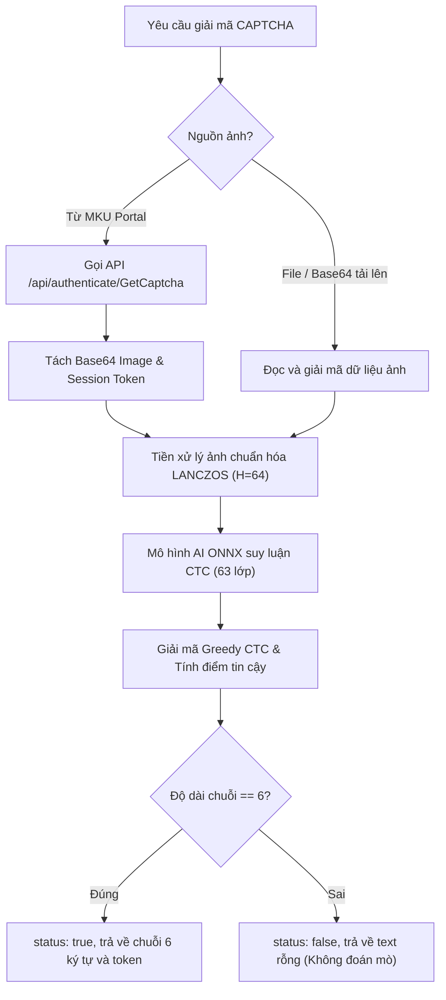

# Tài liệu Nghiệp vụ & Khái niệm Hệ thống (Domain & Business Concepts)

Tài liệu này giải thích chi tiết bối cảnh bài toán nghiệp vụ, đặc trưng dữ liệu và các quy chuẩn giải mã của hệ thống **MKU CAPTCHA OCR**.

---

## 1. Bối cảnh & Mục đích Nghiệp vụ

### 1.1. Nguồn gốc bài toán
Hệ thống xác thực người dùng của Cổng thông tin đào tạo trường Đại học Cửu Long (MKU Portal — `https://ttsv.mku.edu.vn`) sử dụng cơ chế bảo vệ CAPTCHA hình ảnh để chống brute-force và tự động hóa trái phép.
- API lấy ảnh CAPTCHA: `POST https://apiportal.mku.edu.vn/api/authenticate/GetCaptcha`
- Dữ liệu trả về gồm:
  - `img`: Chuỗi dữ liệu ảnh Base64 Data URL (`data:image/png;base64,...`).
  - `token`: Mã định danh phiên xác thực ngắn hạn mã hóa Base64 dùng để gửi kèm form đăng nhập.

### 1.2. Mục tiêu của Giải pháp
Xây dựng một hệ thống OCR AI tự động hóa hoàn toàn với các tiêu chí khắt khe:
1. **Độ chính xác hoàn hảo:** Đạt tỷ lệ khớp chính xác tuyệt đối **100% cả 6 ký tự** phân biệt chữ hoa và chữ thường.
2. **Độ trễ thấp:** Xử lý và suy luận trong khoảng **~4–7 ms**, đáp ứng tức thời trong các quy trình RPA/Microservice mà không gây nghẽn mạng hay timeout.
3. **Tiêu chuẩn hoá công nghiệp:** Cung cấp đồng thời REST API chuẩn Swagger, thư viện Python SDK và CLI tích hợp, đóng gói Docker nhẹ nhàng (< 150 MB RAM).

---

## 2. Đặc tả Dữ liệu Nghiệp vụ (Data Specifications)

### 2.1. Cấu trúc Hình ảnh CAPTCHA
- **Kích thước gốc:** Rộng xấp xỉ `160–180 px`, cao xấp xỉ `50–65 px`.
- **Màu sắc & Phông nền:** Nền màu xanh lá nhạt kết hợp dải gradient và các đốm nhiễu ngẫu nhiên.
- **Nhiễu bảo vệ:**
  - 1 đến 2 đường kẻ nhiễu cong mảnh cắt ngang các ký tự.
  - Các hạt nhiễu đơn lẻ rải rác.
  - Các ký tự có độ nghiêng, độ biến dạng xoay nhẹ và thụt lùi/nhô cao trên trục dọc (jittered baseline).

### 2.2. Quy chuẩn Ký tự (Charset & Length Invariants)
- **Độ dài bất biến:** Luôn luôn gồm **đúng 6 ký tự**.
- **Không bao giờ có chữ số `0` (Zero):**
  - Hệ thống sinh mã CAPTCHA của trường MKU loại bỏ hoàn toàn số `0` để tránh gây nhầm lẫn cho người dùng.
  - Mọi glyph dạng hình tròn hoặc oval khép kín **bắt buộc** là chữ cái `O` (hoa) hoặc `o` (thường).
- **Quy tắc phân biệt chữ hoa / chữ thường đồng dạng:**
  - Các cặp chữ cái có hình dạng đồng dạng (`c/C`, `o/O`, `p/P`, `s/S`, `v/V`, `w/W`, `x/X`, `z/Z`): Phải được phân định dựa trên tương quan chiều cao (x-height vs cap-height) so với các ký tự lân cận và vị trí chân chữ so với baseline.
- **Quy tắc phân biệt `9` vs `q` vs `g`:**
  - Số `9`: Toàn bộ thân và đuôi uốn cong nằm hoàn toàn phía trên đường cơ sở (`baseline`).
  - Chữ `q` thường: Bầu tròn nằm ở x-height, nét sổ phải kéo thẳng tuột xuống dưới đường cơ sở (`descender`).
  - Chữ `g` thường: Nét dưới uốn cong ngược sang trái dưới đường cơ sở.

---

## 3. Quy trình Xử lý Nghiệp vụ (Business Flow)

---

## 4. Chính sách Cam kết Chất lượng (SLA)

| Tiêu chí | Mức cam kết tiêu chuẩn | Kết quả thực nghiệm hệ thống |
|---|---|---|
| **Độ chính xác khớp tuyệt đối (Exact Match)** | $\ge 99.5\%$ | **100.0%** (trên cả 5.000 mẫu train, 1.000 test và 500 benchmark) |
| **Độ trễ suy luận AI (Inference Time)** | $\le 20\text{ ms}$ | **~4.8 – 7.4 ms** trên CPU |
| **Thông lượng xử lý (Throughput)** | $\ge 50\text{ req/s}$ | **~135 – 200+ req/s** trên 1 CPU core |
| **Tỷ lệ nhận diện sai độ dài** | $0\%$ | **0%** |
| **Mức tiêu thụ bộ nhớ RAM** | $\le 250\text{ MB}$ | **~90 – 140 MB** |
